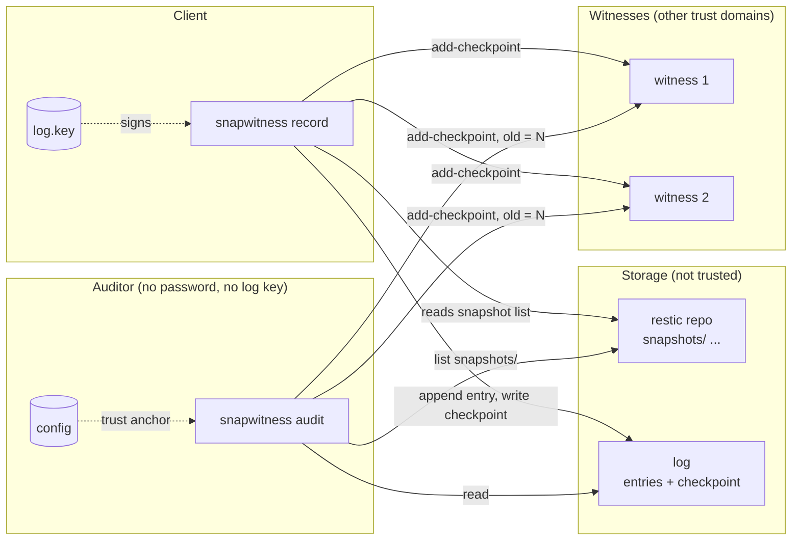
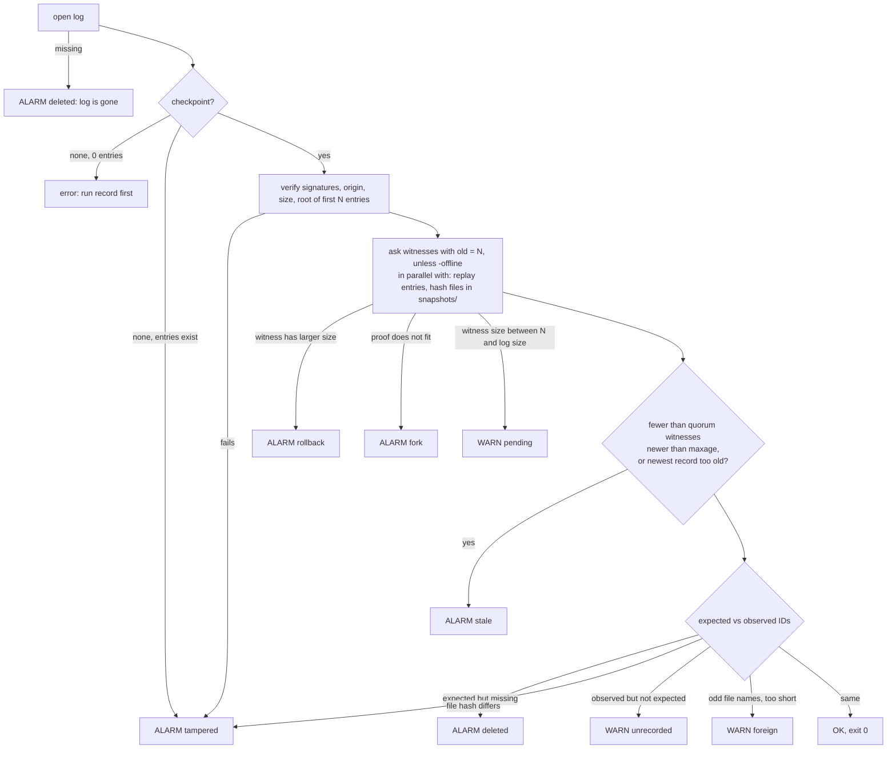

# Design

This page is about how the prototype works and why, and about the formats it writes.

In short: after each backup the client appends a state record to a Merkle log. The log is kept next to the repository, on the same storage that isn't trusted. Witnesses in other trust domains cosign each new log size and add a timestamp. Later an auditor without the restic password compares the storage listing, the log and the witnesses, and finds out when the repository lost snapshots, was rolled back or shows two histories.

## Components

- `record` runs on the client after each backup. It reads the snapshot list with the restic password, appends a state record, signs a checkpoint and collects the witness cosignatures.
- `audit` runs on any host and needs neither the password nor the log key. It lists `snapshots/` on the storage, replays the log and checks the checkpoint and the witnesses.

The log is two files in `logdir`, next to the repository: `entries`, which is append-only, and `checkpoint` with the newest signed note. The witnesses live in other trust domains. They cosign a checkpoint and add a timestamp, but only if it's consistent with what they saw before.

The client and the auditor share the config. It's the trust anchor and holds the origin, the log public key, the witness keys and URLs, the quorum and the maximum age.

In the code, `internal/config` reads and writes the config file and `internal/state` has the record format and the replay. `internal/wlog` is the log with its checkpoints and cosignatures, `internal/witness` the witness client and the parallel collection, and `internal/restic` the keyed reader and the keyless lister. `internal/app` puts it all together: init, record, audit and the reports.



## State record

Each `record` run writes one record. The format is deterministic ASCII text with `\n` line endings:

```text
snapwitness/v0 state
time 2026-10-02T14:02:11Z
tool restic 0.19.1
count 4
set 6d1f0c9a...(64 hex)
+ 9a7f03be...(64 hex)
- 1c22d0e8...(64 hex)
```

- The header comes first, then `time`, `tool`, `count`, `set`, the sorted `+ id` lines and the sorted `- id` lines. The text ends with a newline. There are no trailing spaces and no empty lines.
- `count` is the number of snapshots after this record. `set` is the SHA-256 of `id + "\n"` for every snapshot ID in ascending order. For an empty set it's the hash of empty input.
- `+` lines are the IDs added since the previous record, `-` lines the IDs that were removed.
- The parser refuses anything the writer wouldn't produce. Replay goes through the records in order and checks each one: added IDs must have been absent, removed IDs present, and the count and the set hash have to match. When something fails, the error names the first bad index.
- Every run writes a record, also when nothing changed.

## Log and checkpoint

`entries` keeps each record as a frame: a 4-byte big-endian length, then the record bytes. The file is only ever appended to, and every frame gets an `fsync`. The Merkle tree is the RFC 6962 tree over the records. It's rebuilt in memory every time the log is opened.

`checkpoint` holds the newest signed note. The body is a [C2SP tlog-checkpoint](https://c2sp.org/tlog-checkpoint):

```text
<origin>
<size>
<base64 root hash>
```

The log signs this body, and each witness adds one cosignature line ([C2SP tlog-cosignature](https://c2sp.org/tlog-cosignature)) with its name, a key hash and a timestamp:

```text
— <log name> <base64 signature>
— <witness name> <base64 signature>
```

To replace the file, `record` writes a temporary file, syncs it, renames it and syncs the directory. After a crash you have the old checkpoint or the new one, nothing in between.

## Witness protocol

Both `record` and `audit` talk to the witnesses with `add-checkpoint` from [C2SP tlog-witness](https://c2sp.org/tlog-witness):

```text
POST <URL>/add-checkpoint
old <old size>
<base64 hash>        (zero or more lines: consistency proof from old size)
<empty line>
<signed checkpoint note>
```

A 200 answer has one or more cosignature lines. With 409 the witness says it has seen a different size and puts that size in the body; the client may retry with that size and a proof. 404 means the witness doesn't know this log, 403 is a bad log signature and 400 a bad request. 422 means the consistency proof doesn't match what the witness saw: the history forked.

What the client does with the answers:

- All witnesses are asked in parallel, one goroutine each. A dead witness costs one timeout, and the timeouts don't add up.
- A 409 with a different size that isn't larger than the checkpoint gets one retry, with that size and the matching proof. Here the witness is just behind, or it already has this checkpoint from an earlier run that didn't finish.
- A 409 with a size larger than the checkpoint is never retried. That answer is the evidence of a rollback.
- A 200 answer is parsed strictly. Every line has to be a note signature line ending in a newline; one blank line or anything else and the whole answer is rejected. Each cosignature is checked on its own against the exact checkpoint body that was sent, which means an answer can't move the boundary between the text and the signatures. Lines with other names or keys are skipped. The first valid cosignature from the expected witness is the one used.
- `record` stops once `quorum` witnesses have cosigned and cancels the others.

## Record flow

`record` goes through these steps:

1. Open the log, verify the checkpoint and check the root of the first N entries.
2. Send the same checkpoint to the witnesses again, with `old = N`. This is the rollback probe: a witness either cosigns it or answers with a conflict and a larger size.
3. Run `restic snapshots --json` with the password and diff the list against the replay of the N entries.
4. If a snapshot was removed and `-accept-removed` isn't given, raise `deleted` and append nothing.
5. Otherwise append record N+1 and sign checkpoint N+1.
6. Ask the witnesses with `add-checkpoint`, sending `old = N` and the proof.
   With at least `quorum` cosignatures, write the checkpoint with the log and witness lines. With fewer, raise `quorum` and keep the old checkpoint.

The entry goes into the log before any witness is asked. When the quorum isn't reached, it stays there as a pending tail and the next run tries again. The old checkpoint file stays where it is, and nothing signed gets lost.

## Audit flow



If the observed set is the same as the set of an older record, the rollback report names that record (`the storage matches state #i from <time>`).

You can audit several repositories in one go by repeating `-c`. Each config gets its own audit and its own timeout. The worst exit code wins: 3 beats 1, 1 beats 0.

## Findings

| Finding | Level | Meaning |
|---|---|---|
| `deleted` | alarm | A snapshot in the log is not on the storage, or the log is gone. In `record`, a snapshot disappeared since the last record and `-accept-removed` was not given |
| `rollback` | alarm | A witness has seen a larger log than the storage serves. The storage was probably restored from an older copy |
| `fork` | alarm | A witness holds a history that is not consistent with this log |
| `tampered` | alarm | The log or checkpoint does not verify, the log was truncated, or a snapshot file does not hash to its name |
| `stale` | alarm | Too few witnesses cosigned within `maxage`, or no new state was recorded in that time |
| `quorum` | alarm | `record` could not get enough cosignatures |
| `pending` | warning | A record run did not finish. Run `record` again |
| `unrecorded` | warning | A snapshot is on the storage but not in the log (a backup without `record`) |
| `foreign` | warning | Files in `snapshots/` whose names are not snapshot IDs, or that are too short to be a snapshot |
| `witness` | warning | A witness could not be reached or gave an unusable answer |

## Threats

| Attack by the storage operator | Detected? |
|---|---|
| Delete a snapshot after it was recorded | Yes (`deleted`) |
| Delete the log, or truncate it | Yes (`deleted`, `tampered`) |
| Roll the repository and the log back to an older copy | Yes, if a witness has seen the newer log (`rollback`) |
| Show different histories to different clients | Yes, if both reach the same witnesses (`fork`) |
| Freeze: hide new snapshots and serve the old state | Yes, after `maxage` (`stale`) |
| Change a snapshot file | Yes (`tampered`) |
| Delete a snapshot before its first record | No |
| Collusion of the operator with enough witnesses | No |
| Attacker who has the client, the restic password and the log key | No |
| Prevent any of the above | No, the tool only detects |

## Decisions

I didn't want to run a server for this. The log is a plain file next to the repository and there's nothing extra to operate. The storage isn't trusted anyway, and every claim in it is checked against the log key and the witnesses.

The log is hand-written. Tessera felt like too much for this, the MVP only needs an append-only list of a few thousand records with proofs, and `golang.org/x/mod/sumdb/tlog` gives the RFC 6962 hashes and proofs without an extra dependency.

The witnesses are in the design from the start. A signed log on the same storage proves nothing against a rollback, because the operator can restore the log together with the repository. Only the witnesses remember the newest size.

The entry is appended before any witness is asked. If the program dies after the append, the next run finishes the job. If it dies before, nothing was claimed.

Every run appends a record, even with no change. Such a record still proves the state at that time, and `stale` depends on it.

The audit doesn't need the password. restic names each file in `snapshots/` after the SHA-256 of its contents, which lets the auditor list the snapshot IDs and check every one by hashing its file. restic 0.19.1 panics on a very short file whose name is its hash. Those files are reported as `foreign` and never given to restic.

I kept the dependencies few: `golang.org/x/mod`, `golang.org/x/sync` and `github.com/transparency-dev/formats` for the cosignature format. Everything else is the standard library.

One config file is the trust anchor. `init` writes the origin, the log public key, the witness keys and the quorum into it, and an auditor with a copy needs nothing else.

## Limits

The known limits are in [LIMITATIONS.md](../LIMITATIONS.md).
